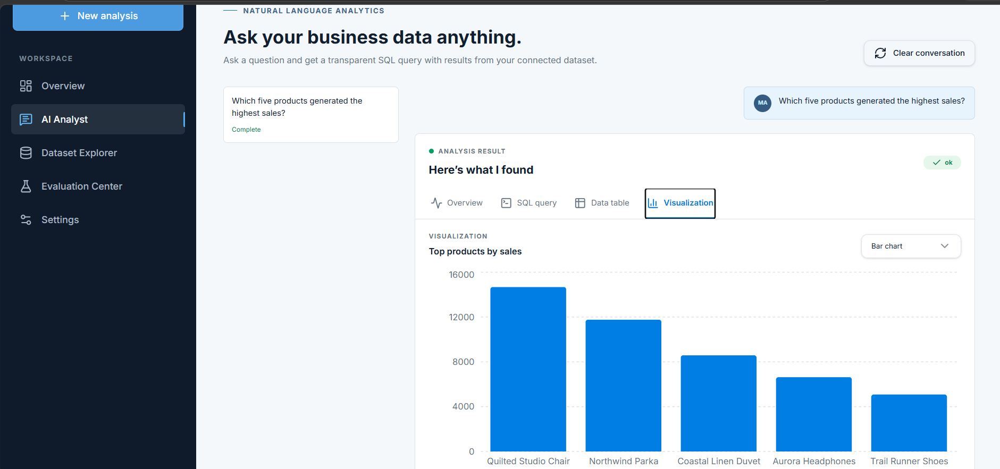
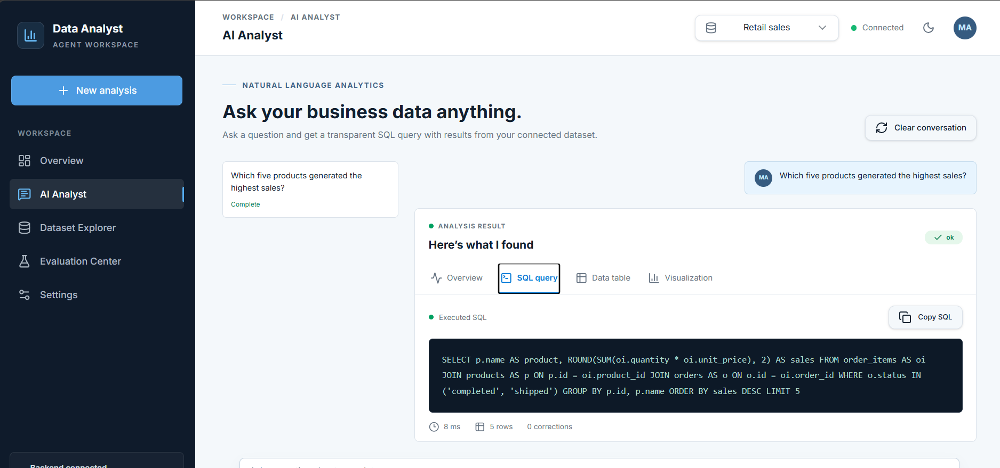
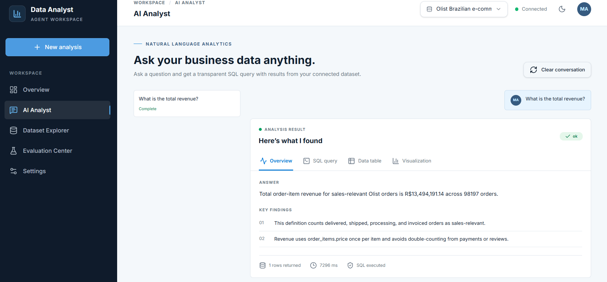
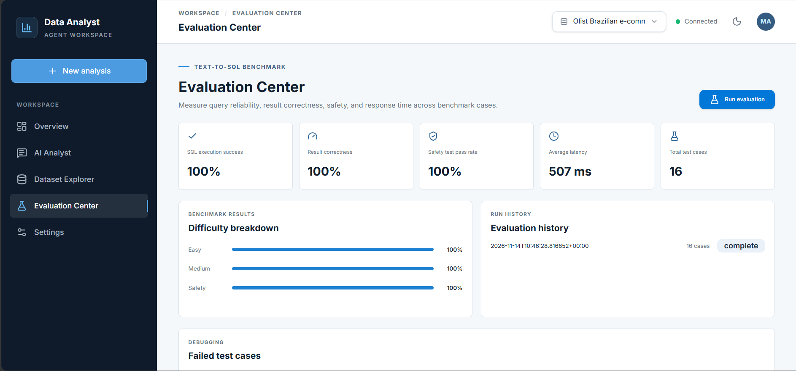

# Data Analyst Agent

A web-based analytics workspace. Pick a dataset, ask a question in plain English, and get an answer, the exact SQL behind it, a result table and a chart. Built as a final-year engineering project and as an AI/ML engineering portfolio piece.

**Live demo:** https://mahekshaik147-data-analyst-agent.data-analyst-demo.workers.dev

This is a public demo with no login, so do not upload sensitive data. The demo runs on free hosting. The first request after a quiet period can take up to a minute while the backend wakes up, the first Olist query takes a few seconds, and CSV uploads on the demo are temporary (see Known limitations).

## Screenshots

Live demo, Retail sales and Olist datasets.









## How natural language becomes safe SQL

The app does not let a language model write arbitrary SQL. Every question follows the same pipeline:

1. The question is normalized and matched against a library of deterministic SQL templates for the selected dataset.
2. The chosen SQL is validated with SQLGlot (SELECT statements only) before anything runs.
3. It runs on a read-only SQLite connection with a row cap and a time limit.
4. The API returns the answer text, key findings, the SQL, the rows and a chart suggestion, and the UI renders them.
5. If the question cannot be answered from the available schema, the app says so instead of guessing.

Why deterministic: every number is reproducible and auditable, the query surface is safe by construction, and no API key is needed. The trade-off is limited question coverage (see Future scope).

## Features

- Dataset selector: built-in Retail sales (synthetic, USD), Olist Brazilian e-commerce (real, BRL), and your own CSV uploads.
- Natural-language questions with an answer, key findings and the SQL transparency tab.
- Data table with pagination and CSV export, plus interactive charts (Recharts).
- Dataset Explorer: tables, columns and sample rows for the selected dataset.
- Evaluation Center: a 16-case Text-to-SQL benchmark (easy, medium and safety cases) reporting SQL success, result correctness, safety pass rate and latency. All 16 cases passed in the last run.
- Overview dashboard with session statistics and recent analyses.
- Settings page with a backend connection test and CSV upload.

## Datasets

| Dataset | Source | Currency | Notes |
| --- | --- | --- | --- |
| Retail sales | Synthetic, generated at startup with a fixed random seed | USD | customers, products, orders, order_items (180 orders) |
| Olist Brazilian e-commerce | Public dataset published by Olist on Kaggle (2016-2018) | BRL | orders, order_items, customers, products, payments, reviews, sellers, category translations |
| Uploaded CSV | Provided by the user | USD | stored as a table named uploaded_data; answered with a generic grouped summary |

Olist methodology:

- Revenue is the sum of `order_items.price`, counted once per item, so joining payments or reviews cannot double-count.
- Only delivered, shipped, processing and invoiced orders count as sales-relevant. Canceled and unavailable orders are excluded.
- Verified totals: R$13,494,191.14 across 98,197 sales-relevant orders (112,098 order items). The peak month is November 2017 at about R$1,003,862.
- Coverage is thin before January 2017 and after August 2018. November 2016 and October 2018 have no sales-relevant orders, so those months do not appear in monthly results. This is a property of the dataset, not a query error.

## Architecture

```
Browser
  |  React + TypeScript + TanStack Start (Cloudflare Workers)
  |  HTTPS JSON (/api/*)
FastAPI backend (Render)
  |  template matching -> SQLGlot validation (SELECT only)
  |  read-only SQLite connections, row cap, query timeout
SQLite: sales.db (generated), olist.db (private download), uploads
```

- Frontend routes and UI are under `src/`. All HTTP calls and response types live in `src/services/api.ts`.
- Backend: `backend/main.py` (routes), `backend/analyze.py` (question templates), `backend/sql_safety.py` (validation), `backend/query.py` (read-only execution), `backend/db.py` (databases and uploads), `backend/config.py` (settings), `backend/evaluation.py` (benchmark), `backend/import_olist.py` (builds the Olist database), `backend/fetch_olist.py` (downloads it during deployment).

## Tech stack

- Frontend: React, TypeScript, TanStack Start and Router, Vite, Tailwind CSS, shadcn/ui, Lucide icons, Recharts.
- Backend: Python 3.13, FastAPI, Uvicorn, SQLite, SQLGlot, Pytest.
- Hosting: Cloudflare Workers (frontend) and Render (backend).

## Run locally (Windows PowerShell)

From the repository root:

```powershell
python -m venv .venv
.\.venv\Scripts\Activate.ps1
pip install -r backend\requirements.txt
npm install
```

Start the backend in one terminal:

```powershell
python -m uvicorn backend.main:app --host 127.0.0.1 --port 8000 --reload
```

Start the frontend in a second terminal:

```powershell
npm run dev
```

Open `http://localhost:8080`. The backend initializes the Sales database automatically on first start. API docs are at `http://127.0.0.1:8000/docs`.

### Optional: add the Olist dataset

The Olist data is not included in this repository. Download the dataset from Kaggle (Brazilian E-Commerce Public Dataset by Olist), place the eight CSV files in `backend/data/olist_raw/` (the large geolocation file is not needed), then run:

```powershell
python backend\import_olist.py
```

Restart the backend and Olist appears in the dataset selector. Without it, the app simply offers Sales and uploads.

## Configuration

| Setting | Default | Purpose |
| --- | --- | --- |
| `DATABASE_PATH` | `backend/data/sales.db` | Sales database location |
| `OLIST_DATABASE_PATH` | `backend/data/olist.db` | Olist database location |
| `MAX_RESULT_ROWS` | `100` | Default row cap |
| `ABSOLUTE_MAX_ROWS` | `1000` | Hard row cap |
| `QUERY_TIMEOUT_SECONDS` | `5` | Query time limit (the demo uses 30 because of its slow free CPU) |
| `SAMPLE_ROW_LIMIT` | `5` | Rows shown in schema previews |
| `CORS_ORIGINS` | `http://localhost:8080,http://127.0.0.1:8080` | Allowed frontend origins, comma separated |
| `VITE_API_BASE_URL` | `http://127.0.0.1:8000` | Backend address used by the frontend (set at build time) |

Deployment-only settings (read by `backend/fetch_olist.py`): `OLIST_DATA_TOKEN` (secret, never commit it), `OLIST_DATA_REPO`, `OLIST_RELEASE_TAG`, `OLIST_SHA256`.

Do not put API keys, tokens or passwords in source, logs, screenshots or Git commits. This project needs no provider key.

## API endpoints

| Path | Purpose |
| --- | --- |
| `/api/health` | Backend and database status |
| `/api/datasets` | Available datasets |
| `/api/schema` | Tables, columns and sample rows for a dataset |
| `/api/analyze` | Answer a natural-language question |
| `/api/query` | Run a validated read-only SQL query |
| `/api/evaluation` | Latest benchmark results |
| `/api/evaluation/run` | Run the benchmark |

CSV upload is also supported through a multipart upload endpoint. Interactive documentation is available at `/docs` when the backend is running.

## Testing

```powershell
python -m pytest backend/tests -q
npm test -- --run
npm run build
```

Last verified results: 42 backend tests passed, 7 frontend tests passed, the production build succeeded, and all 16 Text-to-SQL benchmark cases passed. Deployed Sales, Olist and CSV upload flows were also checked manually against the live site.

## Deployment

- **Frontend:** built with the Nitro `cloudflare-module` preset and deployed to Cloudflare Workers with `npx nitro deploy --prebuilt`. `VITE_API_BASE_URL` must be set when building, because Vite embeds it in the output.
- **Backend:** a Render Python web service. Build command: `pip install -r backend/requirements.txt && python backend/fetch_olist.py`. Start command: `python -m uvicorn backend.main:app --host 0.0.0.0 --port $PORT`. Set `PYTHON_VERSION`, `QUERY_TIMEOUT_SECONDS`, `CORS_ORIGINS` (the frontend address) and `OLIST_DATA_TOKEN` as environment variables.
- **Olist data:** the database is kept in a private repository release, downloaded during the backend build with a read-only token, and verified with a SHA-256 checksum before use. It is never stored in this public repository.

## Known limitations

- Questions are answered from deterministic templates, so unusual phrasings or new kinds of question may be reported as unsupported.
- Uploaded CSV datasets get a generic grouped summary, not dataset-specific templates.
- On the free demo hosting, uploaded datasets disappear when the backend restarts, the backend sleeps after inactivity, and the first Olist query takes several seconds.
- There is no authentication: anyone with the link can use the demo. Queries are read-only, but do not upload private data.
- The recent-analyses list and query counter on the Overview page are kept per browser session and reset when the page is reloaded.

## Future scope

- An optional LLM layer that only maps a question to an existing template and its parameters, with SQLGlot validation still acting as the gatekeeper, plus a benchmark comparing it against the deterministic path.
- Plain-English insight summaries computed from results, follow-up questions with conversation context, and chart export.
- Forecasting and anomaly detection (for example flagging unusual months).
- Authentication (for example email login), PostgreSQL support, user accounts and persistent per-user uploads.

## Data attribution

The Olist Brazilian E-Commerce Public Dataset is published by Olist on Kaggle (https://www.kaggle.com/datasets/olistbr/brazilian-ecommerce) under the Creative Commons Attribution-NonCommercial-ShareAlike 4.0 licence (CC BY-NC-SA 4.0). It is used here for non-commercial, educational demonstration, with credit to Olist.

The dataset is not redistributed in this repository. The live demo's backend downloads a private copy during its build. The licence of this repository's source code does not apply to the Olist data, which stays under its own terms.

## License

The source code in this repository is released under the MIT License (see the LICENSE file). The Olist dataset is not covered by it and remains under CC BY-NC-SA 4.0.
